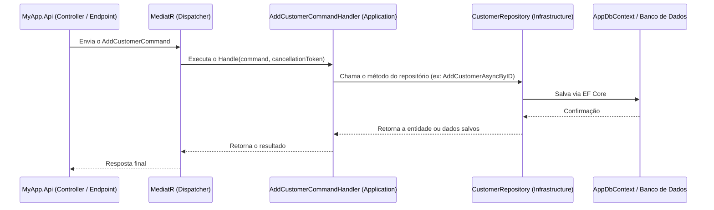

# Explicação do Conjunto: Command, Entity, Interfaces, Repositories e Handler

Este documento explica como funcionam em conjunto as estruturas do padrão CQRS/MediatR com Clean Architecture no projeto, diferenciando o que foi criado por você e o que pertence ao C# ou a bibliotecas externas.

---

## 1. Visão Geral do Fluxo



---

## 2. O que é seu vs. O que é do C# / Bibliotecas

### **Suas Estruturas (Criadas por você no projeto)**

1. **`CustomerEntity` (`MyApp.Core`)**: Representa a entidade de domínio e a tabela no banco de dados.
2. **`ICustomerRepository` (`MyApp.Core`)**: Contrato/interface que define as operações de banco de dados disponíveis para o domínio.
3. **`CustomerRepository` (`MyApp.Infrastructure`)**: Implementação concreta do repositório usando o EF Core (`AppDbContext`).
4. **`AddCustomerCommand` e `AddCustomerCommandHandler` (`MyApp.Application`)**:
   - O **Command** transporta os dados necessários.
   - O **Handler** contém a regra de negócio do caso de uso e aciona o repositório.

### **O que é do C# e de Bibliotecas Externas**

1. **`MediatR`** (Biblioteca NuGet): Fornece as interfaces `IRequest<T>` e `IRequestHandler<TRequest, TResponse>` para desacoplar a chamada da execução.
2. **`record` (C# 9+)**: Usado em `public record AddCustomerCommand(...)` para criar classes imutáveis focadas em portar dados com igualdade baseada em valores.
3. **Primary Constructor (C# 12+)**: Usado em `public class AddCustomerCommandHandler(ICustomerRepository customerRepository)` para injetar dependências diretamente sem precisar declarar campos privados de forma verbosa.
4. **`Task<T>` e `async`/`await` (C# / .NET)**: Permitem a execução assíncrona de operações de I/O (como salvar no banco).
5. **`CancellationToken`**: Mecanismo nativo do .NET para propagar o sinal de cancelamento de requisições caso o cliente feche a conexão ou cancele a operação.

---

## 3. Exemplo Prático Analisado (`AddCustomerCommand.cs`)

No arquivo atual:

```csharp
public record AddCustomerCommand(CustomerEntity Customer) : IRequest<CustomerEntity>;

public class AddCustomerCommandHandler(ICustomerRepository customerRepository) : IRequestHandler<AddCustomerCommand, CustomerEntity>
{
    public async Task<CustomerEntity> Handle(AddCustomerCommand request, CancellationToken cancellationToken)
    {
        return await customerRepository.AddCustomerAsyncByID(request.Customer);
    }
}
```

- **`IRequest<CustomerEntity>`**: Informa ao MediatR que este comando retorna um `CustomerEntity`.
- **Primary Constructor**: O parâmetro `ICustomerRepository customerRepository` é injetado automaticamente pelo container de DI do .NET.
- **`Handle`**: Método obrigatório exigido pelo `IRequestHandler` que executa a lógica de negócio associada ao comando.
