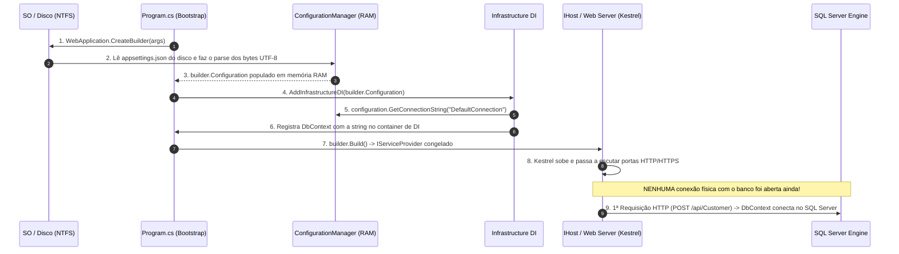

# 15: Leitura de Configurações no .NET: Ordem de Execução, appsettings.json e IConfiguration

---

## 1. O Enredo do Exercício (Cenário e Gargalo Físico Real)

- **Cenário & Volumetria de Negócio:**
  Uma API empresarial em ASP.NET Core (.NET 10) que deve operar em múltiplos ambientes (Desenvolvimento local, Staging em nuvem e Produção com réplicas escaláveis). O banco de dados muda de endereço IP, credenciais e parâmetros de criptografia conforme o ambiente, exigindo desacoplamento total entre código-fonte compilado e parâmetros de infraestrutura (conforme o 3º princípio do *The Twelve-Factor App: Config*).
- **Onde está a dor física e de engenharia?**
  1. **Falha de Compilação Sintática:** Colar a sintaxe JSON (`"DefaultConnection": "..."`) diretamente dentro de um arquivo de código C# viola a gramática do compilador Roslyn, emitindo erros léxicos fatais (`CS1002`, `CS1525`).
  2. **Ordem de Inicialização (Quem lê o quê e quando?):** Entender a linha do tempo física do runtime do .NET: em qual nanossegundo o arquivo `appsettings.json` é lido do disco? Quando a memória RAM do `ConfigurationManager` é populada? E quando o Entity Framework Core de fato utiliza a string de conexão para abrir o socket com o banco de dados?
  3. **Segurança e Vazamento de Credenciais:** Manter strings de conexão no código C# gera strings embutidas nos metadados do assembly `.dll` (tabela de strings do CLR), expondo senhas em decompiladores como ILSpy ou no controle de versão (Git).

---

## 2. As Variáveis Físicas (Hardware, OS e Infraestrutura)

| Etapa / Recurso | Latência / Métrica Física | O que acontece no Sistema Operacional e no Runtime |
| :--- | :--- | :--- |
| **Syscall de I/O em Disco (`NtReadFile` / NVMe)** | ~15 a 50 µs | O Windows Kernel abre o arquivo `appsettings.json` do sistema de arquivos NTFS/ReFS e transfere os blocos para o Page Cache. |
| **Parser UTF-8 (`Utf8JsonReader` na RAM)** | ~0.1 a 0.5 ms de CPU | Leitura dos bytes UTF-8 em memória sem alocações intermediárias de string (*Span-based parsing*). |
| **Tabela Hash de Configuração (Heap Gen 0)** | ~20 a 100 ns por busca | O .NET indexa as chaves em uma estrutura de dados de busca $\mathcal{O}(1)$ (`ConfigurationRoot`). |
| **Abertura de Socket TCP / Named Pipe para SQL** | ~1 a 5 ms (apenas na 1ª requisição) | A connection string só é de fato consumida fisicamente quando a primeira query ou comando é executado, acionando o driver `Microsoft.Data.SqlClient`. |

---

## 3. A "Fórmula" e o Algoritmo (Hierarquia e Precedência de Configurações)

### 3.1. O Algoritmo de Precedência de Configuração no .NET

O `WebApplicationBuilder` implementa um padrão de **sobreposição em cascata (Layered Fallback)**. A configuração final é calculada como uma união onde as fontes posteriores sobrescrevem as anteriores:

$$\text{Config}(k) = \text{CommandLineArgs}[k] \succ \text{EnvironmentVariables}[k] \succ \text{UserSecrets}[k] \succ \text{appsettings}.\{\text{Env}\}.\text{json}[k] \succ \text{appsettings.json}[k]$$

Se você definir `"DefaultConnection"` no `appsettings.json`, mas injetar uma variável de ambiente `ConnectionStrings__DefaultConnection` no Docker/Kubernetes, a variável de ambiente **vence** e tem precedência automática sem alterar uma única linha de código C#.

### 3.2. A "Fórmula" do Helper `GetConnectionString`

No .NET, a chamada:
```csharp
configuration.GetConnectionString("DefaultConnection")
```
É uma função de conveniência padronizada matematicamente equivalente a:
$$\text{GetConnectionString}(name) \equiv \text{configuration}[\text{"ConnectionStrings:"} + name]$$

Ela realiza uma busca $\mathcal{O}(1)$ na seção `"ConnectionStrings"` do dicionário hierárquico indexado em memória.

---

## 4. Primitivas de Baixo Nível + Linha do Tempo de Execução

### 4.1. Qual Código Executa Primeiro? (A Linha do Tempo Exata)

Aqui está a sequência cronológica de eventos do momento em que você roda `dotnet run`:



#### Passo 1: O Bootstrap (`Program.cs`)
```csharp
var builder = WebApplication.CreateBuilder(args);
```
É **aqui** que o `appsettings.json` é lido fisicamente do disco! O método interno `HostApplicationBuilder` faz a leitura dos arquivos de configuração, variáveis de ambiente e argumentos de linha de comando. Ao final dessa linha, `builder.Configuration` já está 100% carregado na memória RAM.

#### Passo 2: O Registro de Injeção de Dependência
```csharp
builder.Services.AddInfrastructureDI(builder.Configuration);
```
Passamos o objeto `builder.Configuration` para o método de extensão da camada de infraestrutura.

#### Passo 3: A Extração da String e Registro do DbContext
```csharp
// MyApp.Infrastructure/DependencyInjection.cs
public static IServiceCollection AddInfrastructureDI(this IServiceCollection services, IConfiguration configuration)
{
    // Lê o valor da chave "ConnectionStrings:DefaultConnection"
    var connectionString = configuration.GetConnectionString("DefaultConnection");

    // Configura o DbContext para usar o provedor do SQL Server
    services.AddDbContext<AppDbContext>(options =>
    {
        options.UseSqlServer(connectionString);
    });

    services.AddScoped<ICustomerRepository, CustomerRepository>();
    return services;
}
```

#### Passo 4: A Construção do Host (`builder.Build()`)
O container de injeção de dependência é compilado e validado.

#### Passo 5: A Conexão com o Banco (Lazy Initialization)
**Importante:** O Entity Framework Core **não** abre a conexão com o banco de dados durante a inicialização da API! A conexão só é solicitada fisicamente pela CPU quando a primeira requisição chega no controller e o repositório executa a primeira query ou chamada `SaveChangesAsync()`.

---

## 5. Segurança Defensiva, Primitivas Criptográficas & OWASP

### 5.1. OWASP A02:2021 – Cryptographic Failures & A05:2021 – Security Misconfiguration

1. **Nunca use Strings Hardcoded em C#:**
   Quando você escreve credenciais no arquivo `.cs`, elas são compiladas dentro do binário `.dll` como constantes na seção de metadados (`#Strings` stream da especificação ECMA-335). Qualquer ferramenta de engenharia reversa consegue extrair os dados em texto claro.
2. **Ambiente Local vs Produção:**
   - **Em Desenvolvimento Local:** O `appsettings.json` pode conter conexões para `(localdb)` com autenticação integrada do Windows (`Integrated Security=True`).
   - **Para Senhas de Desenvolvedor:** Utilize o mecanismo seguro de *User Secrets*:
     ```bash
     dotnet user-secrets init --project MyApp.Api
     dotnet user-secrets set "ConnectionStrings:DefaultConnection" "Data Source=...;User Id=...;Password=..." --project MyApp.Api
     ```
     O User Secrets salva os dados fora do diretório do projeto (`%APPDATA%\Microsoft\UserSecrets`), impedindo commits acidentais no Git.
3. **Criptografia em Trânsito (TLS/mTLS):**
   Sua connection string no `appsettings.json` já conta com `Encrypt=True;TrustServerCertificate=True;`. Em ambiente de produção empresarial, altere para `TrustServerCertificate=False;` para validar a autoridade certificadora (CA) do servidor SQL e mitigar ataques *Man-in-the-Middle (MitM)*.

---

## 6. Mapeamento de Possibilidades e Trade-offs (Matriz de Decisão)

| Abordagem | Segurança & Segredos | Flexibilidade de DevOps / Cloud | Facilidade de Manutenção | Veredito de Engenharia |
| :--- | :--- | :--- | :--- | :--- |
| **1. String Hardcoded no C#** | ❌ Crítica: senhas fixas no binário `.dll` e no repositório Git. | ❌ Nula: exige recompilação e novo deploy para alterar banco. | ❌ Péssima. | ❌ **Inaceitável.** |
| **2. appsettings.json com `IConfiguration` (Implementado)** | ⚠️ Médio: seguro se não contiver senhas de produção no Git. | ✅ Alta: alterável por ambiente via `appsettings.Development.json` e `appsettings.Production.json`. | ✅ Excelente. | ✅ **Padrão de Mercado.** |
| **3. Variáveis de Ambiente (Docker/K8s)** | ✅ Alta: segredos injetados pelo runtime do container. | 🚀 Máxima: aderente ao Twelve-Factor App sem arquivos em disco. | ✅ Excelente. | 🚀 **Recomendado para Nuvem/Containers.** |
| **4. Cloud Vault (Azure Key Vault / AWS Secrets)** | 🛡️ Máxima: criptografia HSM, auditoria de acesso e rotação automática de chaves. | 🚀 Máxima: centralizado em infraestrutura corporativa. | ⚠️ Exige autenticação gerenciada (Managed Identity). | 🔒 **Padrão Corporativo para Produção.** |

---

## Resumo das Modificações Realizadas

1. **No arquivo [MyApp.Infrastructure/DependencyInjection.cs](file:///c:/Users/xvine/Desktop/C%23_CLEAN/MyApp.Infrastructure/DependencyInjection.cs):**
   Removemos a string quebrada e adicionamos o método que recebe `IConfiguration` e extrai `configuration.GetConnectionString("DefaultConnection")`.
2. **No arquivo [MyApp.Api/Program.cs](file:///c:/Users/xvine/Desktop/C%23_CLEAN/MyApp.Api/Program.cs):**
   Passamos `builder.Configuration` para a camada de infraestrutura:
   ```csharp
   builder.Services
       .AddCoreDI()
       .AddApplicationDI()
       .AddInfrastructureDI(builder.Configuration)
       .AddApiDI();
   ```
3. **No arquivo [MyApp.Api/DependencyInjection.cs](file:///c:/Users/xvine/Desktop/C%23_CLEAN/MyApp.Api/DependencyInjection.cs):**
   Limpamos as chamadas duplicadas para manter cada camada com sua responsabilidade única.
