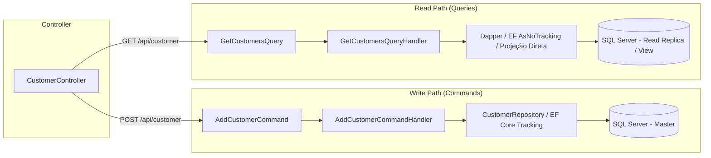

# 17: CQS & CQRS: Por Que Separar Commands e Queries, o Anti-Pattern da "Query que Chama Command" e o Custo Físico do Overengineering

---

## 1. O Enredo do Exercício (Cenário e Gargalo Físico Real)

- **Cenário & Volumetria de Negócio:**
  Um desenvolvedor assiste a um tutorial onde o autor cria uma "camada de query que aponta para command" ou cria sistematicamente uma Query para cada Command, sentindo que a Query apenas "encapsula o que já existe sem abstrair nada". Em sistemas reais de alto tráfego (10.000 req/s), mais de 90% a 98% do tráfego são operações de **leitura** (SELECTs, dashboards, feeds, buscas) e apenas 2% a 10% são operações de **escrita** (INSERTs, UPDATEs de checkout, pagamentos).
- **Onde está a dor física e de engenharia?**
  1. **O Anti-Pattern Conceitual ("Query Apontando para Command"):**
     Se uma Query dispara um Command ou vice-versa, isso viola frontalmente o princípio **CQS (*Command-Query Separation*)** de Bertrand Meyer. Uma Query (que no protocolo HTTP é um `GET`) deve ser estritamente pura e idempotente. Se uma Query causar mutações de estado através de um Command:
     - Navegadores web e crawlers de busca (Googlebot) que fazem pré-carregamento (*prefetch*) de links `GET` disparariam mutações de dados acidentais no banco!
     - CDNs (Cloudflare, CloudFront) fariam cache da primeira resposta e ignorariam as alterações subsequentes.
  2. **O Anti-Pattern do "Overengineering / CRUD Disfarçado de CQRS":**
     Se a sua aplicação cria para cada `Customer`:
     `CreateCustomerCommand`, `CreateCustomerQuery`, `GetCustomerCommand`... onde um apenas repassa dados para o outro sem nenhuma diferença de modelo ou processamento, você adicionou **3 camadas extras de indireção de delegates e alocações no Heap** sem colher nenhum benefício do padrão.
  3. **Contenção Física no Banco de Dados (Locks `S` vs `X`):**
     - **Escritas (Commands):** Exigem travas exclusivas (`X-Lock`), gravação síncrona no disco no arquivo de log de transação (*Write-Ahead Logging* / `.ldf`) e acionamento de Change Tracker no EF Core.
     - **Leituras (Queries):** Não precisam de locks transacionais nem de Change Tracker. Podem rodar com `AsNoTracking()`, Dapper ou serem direcionadas para réplicas de leitura (*Read Replicas*).

---

## 2. As Variáveis Físicas (Hardware, OS e Infraestrutura)

| Operação / Recurso | Write Path (Commands) | Read Path (Queries Otimizadas) | Diferença Física de Performance |
| :--- | :--- | :--- | :--- |
| **Alocação de Heap (RAM)** | Aloca Entidade + `EntityEntry` no ChangeTracker + Shadow Properties (~2 a 4 KB por objeto). | Projeção direta via DTO (`Select(x => new Dto(...))`) (~200 a 400 bytes). | **~5x a 10x menos memória** no Read Path. |
| **CPU (Garbage Collector)** | Objetos rastreados sobrevivem por mais tempo, pressionando a Gen 1 do GC. | DTOs de leitura morrem instantaneamente no fim do escopo (Gen 0 ultra-rápida). | Reduz pausas de *Stop-the-World* do GC. |
| **I/O de Disco (SQL Server)** | Gravação forçada em disco via `FlushFileBuffers` no `.ldf` para garantir durabilidade ACID. | Leitura servida diretamente do **Buffer Pool (RAM do SQL Server)** sem tocar o disco. | Leituras são de 100x a 1.000x mais rápidas que escritas. |
| **Locks no Banco (Engine Relacional)** | Adquire Exclusive Locks (`X`) que bloqueiam outras sessões. | Opera sob `READ_COMMITTED_SNAPSHOT` (sem locks de leitura) ou em réplicas secundárias. | **Zero contenção de concorrência.** |

---

## 3. A "Fórmula" e o Algoritmo (O Princípio CQS Matemático)

### 3.1. O Teorema CQS (Bertrand Meyer, 1988)

Toda operação em software é classificada de forma disjunta:

$$\text{Operações} = \text{Commands} \cup \text{Queries}, \quad \text{onde } \text{Commands} \cap \text{Queries} = \emptyset$$

Formalismo de Estados:
Seja $S_t$ o estado do sistema no instante $t$:

1. **Definição de Command (Modificador de Estado):**
   $$f_{\text{Command}}(S_t, \text{args}) \implies S_{t+1} \neq S_t, \quad \text{Retorno} \in \{\emptyset, \text{Id}, \text{ResultStatus}\}$$
   *Commands causam efeito colateral (side-effect). Eles mudam o mundo.*

2. **Definição de Query (Leitor de Estado):**
   $$f_{\text{Query}}(S_t, \text{args}) \implies S_{t+1} = S_t, \quad \text{Retorno} = \text{Data Projection}$$
   *Queries são funções puras (idempotentes). A pergunta não pode alterar a resposta.*

### 3.2. Por Que a "Query Chamando Command" É Um Erro Grave

Se uma função de leitura chama uma função de mutação:
$$f_{\text{Query}}(S_t) \implies S_{t+1} \neq S_t$$
A propriedade fundamental da **idempotência de leitura** é destruída:
$$f_{\text{Query}}(f_{\text{Query}}(S_t)) \neq f_{\text{Query}}(S_t)$$
Isso quebra caches de HTTP, quebra CDNs e introduz comportamentos imprevisíveis sob concorrência.

---

## 4. Primitivas de Baixo Nível + Sintaxe da Linguagem + Design Patterns

### 4.1. O Que É o CQRS Real? (Greg Young)

O CQRS (*Command Query Responsibility Segregation*) surge quando você percebe que:
- **O modelo mental para gravar dados é diferente do modelo mental para exibir dados.**
- Ao cadastrar um cliente (Command), você precisa de validação de CPF, hashing de senhas, validação de limite de crédito e eventos de auditoria.
- Ao listar clientes em uma grid com paginação (Query), você só precisa de: `Id`, `Nome` e `DataCadastro`. Não precisa carregar tabelas associadas, nem entidades de domínio, nem executar validações de negócio complexas.



### 4.2. O Código na Prática: A Diferença Abissal entre Command e Query

#### 1. O Command (Foco em Regras de Negócio, Transação e Invariantes)
```csharp
// MyApp.Application/Commands/AddCustomerCommand.cs
public record AddCustomerCommand(string Name, string Email, string Phone) : IRequest<Guid>;

public class AddCustomerCommandHandler(AppDbContext db) : IRequestHandler<AddCustomerCommand, Guid>
{
    public async Task<Guid> Handle(AddCustomerCommand cmd, CancellationToken ct)
    {
        // 1. Validações de Domínio e Invariantes
        var customer = new CustomerEntity
        {
            Id = Guid.NewGuid(),
            Name = cmd.Name,
            Email = cmd.Email,
            Phone = cmd.Phone
        };

        // 2. Persistência via Change Tracker
        db.Customers.Add(customer);
        await db.SaveChangesAsync(ct);

        return customer.Id; // Retorna apenas o ID gerado
    }
}
```

#### 2. A Query (Foco em Performance Pura, Zero Tracking e Projeção Leve)
```csharp
// MyApp.Application/Queries/GetCustomerSummaryQuery.cs
public record CustomerSummaryDto(Guid Id, string Name, string Email);

public record GetCustomerSummaryQuery(int Page, int PageSize) : IRequest<List<CustomerSummaryDto>>;

public class GetCustomerSummaryQueryHandler(AppDbContext db) : IRequestHandler<GetCustomerSummaryQuery, List<CustomerSummaryDto>>
{
    public async Task<List<CustomerSummaryDto>> Handle(GetCustomerSummaryQuery qry, CancellationToken ct)
    {
        // 1. AsNoTracking() diz ao EF Core: "NÃO aloque ChangeTracker para esses objetos no Heap!"
        // 2. Select() gera um SQL que busca SOMENTE as 3 colunas necessárias (economiza I/O de rede e RAM)
        return await db.Customers
            .AsNoTracking()
            .OrderBy(c => c.Name)
            .Skip((qry.Page - 1) * qry.PageSize)
            .Take(qry.PageSize)
            .Select(c => new CustomerSummaryDto(c.Id, c.Name, c.Email))
            .ToListAsync(ct);
    }
}
```

> **A sua intuição está 100% correta:** Se a Query não fizer uma projeção otimizada, ou se ela simplesmente chamar um Command por baixo dos panos, ela não abstrai nada e é mero ruído arquitetural (overengineering). O valor do CQRS só se manifesta quando o caminho de leitura é **otimizado de forma diferente** do caminho de escrita.

---

## 5. Segurança Defensiva, Primitivas Criptográficas & OWASP

### 5.1. OWASP API3:2023 – Broken Object Property Level Authorization

- **No Command:** Impede *Mass Assignment*. Você nunca recebe a entidade crua no payload. O Command recebe apenas os campos que o usuário tem permissão de preencher.
- **Na Query:** Impede *Data Exposure*. A Query nunca deve retornar a entidade de domínio completa, pois ela pode conter campos sensíveis como `PasswordHash`, `InternalNotes`, `CreditCardTokens` ou `TenantId`. A Query projeta um DTO contendo **apenas os campos públicos autorizados**.

### 5.2. Segurança em Caches HTTP e Ataques de CSRF

Se uma Query executasse mutação de dados:
1. **CSRF via Tags HTML:** Uma imagem `` em um site malicioso dispararia uma requisição `GET`. Se o seu sistema tratar essa Query com efeitos colaterais de Command, os dados do usuário logado seriam deletados silenciosamente.
2. **CQS Protege a RFC do HTTP:** O método `GET` do HTTP é definido pela RFC 9110 como seguro (*safe*) e idempotente. Separar Queries de Commands garante estrita conformidade com a segurança da web.

---

## 6. Mapeamento de Possibilidades e Trade-offs (Matriz de Decisão)

| Arquitetura | Esforço de Código | Benefício Real | Quando Utilizar? | Veredito de Engenharia |
| :--- | :--- | :--- | :--- | :--- |
| **1. Query Chamando Command / Query Espelho 1:1 Inútil** | Alto (cria classes redundantes sem propósito). | Zero. Apenas consome CPU, memória e dificulta a depuração. | Nunca (é um anti-pattern de tutorial fraco). | ❌ **Rejeitar (Overengineering).** |
| **2. CRUD Tradicional com Controller + Service** | Baixo (poucos arquivos, fluxo direto). | Suficiente para 80% das aplicações simples de mercado. | APIs pequenas, MVPs, cadastros simples sem regras complexas. | ✅ **Válido para cenários simples.** |
| **3. CQRS na Mesma Base (Commands via EF Core + Queries via AsNoTracking/Dapper)** | Médio (separa claramente quem escreve de quem lê). | Alto: máxima velocidade de leitura, zero overhead de ChangeTracker, código desacoplado. | APIs em crescimento, sistemas corporativos com alta leitura. | 🚀 **Recomendado (Clean Architecture Real).** |
| **4. CQRS com Bases de Dados Separadas (Read DB vs Write DB + Event Sourcing)** | Altíssimo (exige mensageria, outbox pattern, consistência eventual). | Escalabilidade infinita de leitura (ex: ElasticSearch/Redis para buscas + Postgres para escrita). | E-commerces globais, bancos digitais, streaming (Netflix, Nubank). | 🔒 **Apenas para Altíssima Escala.** |

---

## Conclusão Direta à Sua Dúvida

1. **Você tem total razão de desconfiar:** Criar uma Query só para "encapsular" um Command ou criar uma Query espelho para cada Command sem nenhuma lógica de leitura otimizada é **anti-pattern e overengineering puro**.
2. **A Query nunca deve apontar para um Command:** A Query lê dados sem alterar nada; o Command altera dados com regras de negócio.
3. **A verdadeira vantagem da Query:** Quando você precisa ler dados para a tela, você não deve carregar a entidade pesada do EF Core. A Query vai direto ao banco (via `AsNoTracking()` ou Dapper) e traz apenas as colunas que a tela precisa, gastando 10 vezes menos memória RAM da sua máquina.
